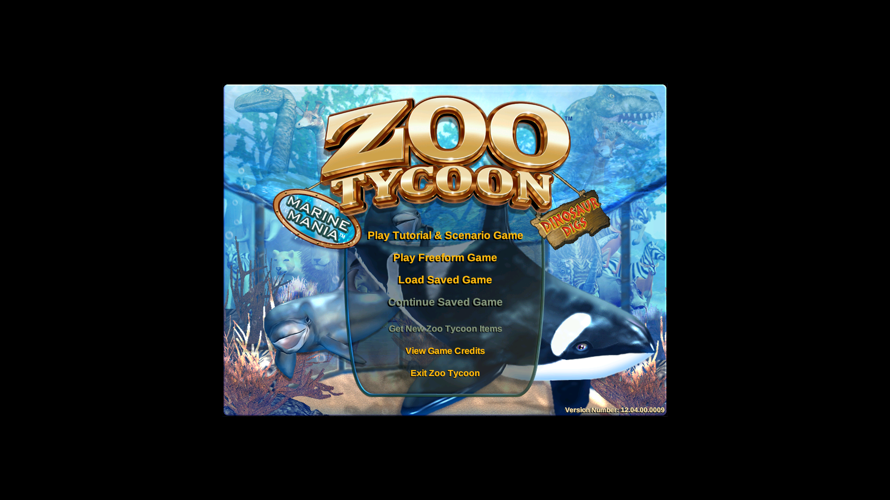
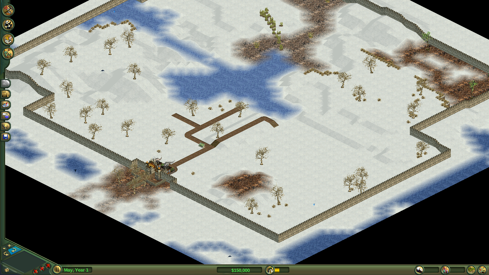
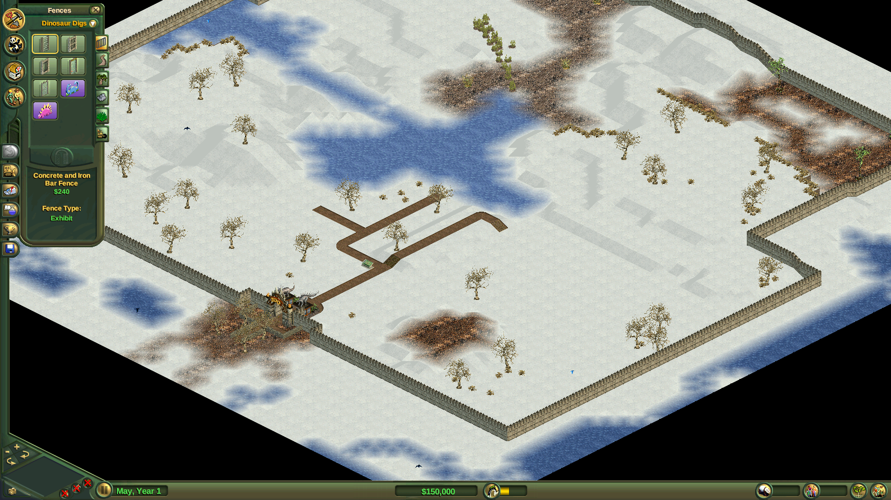

<div align="center">

# RustyZoo

**A fan-made, open-source remake of the Zoo Tycoon (2001) engine, written in Rust.**

[](https://github.com/dekkaaa9/zoo-tycoon-port/actions/workflows/ci.yml)
[](LICENSE)


[Screenshots](https://github.com/RustyZoo/screenshots) · [Roadmap](https://github.com/dekkaaa9/zoo-tycoon-port/milestones) · [Project board](https://github.com/orgs/RustyZoo/projects/1) · [Usage](docs/usage.md)

</div>

RustyZoo is a standalone program that plays the original game from the data of your own copy, the way [OpenRCT2](https://openrct2.io/) does for RollerCoaster Tycoon.

We love this game and want it to keep running on today's computers, unchanged: same rules, same look, same animals with the same moods.

> [!IMPORTANT]
> RustyZoo contains no part of the original game: no code, no pictures, no sounds, no text. You need your own copy of the game (see [below](#you-need-the-game)). RustyZoo is not affiliated with or endorsed by Microsoft or Blue Fang Games.

## Where we are

RustyZoo is not finished, but you can already play a freeform zoo.

| | Feature |
| :---: | --- |
| ✅ | Main menu, freeform maps, starting cash |
| 🚧 | Research, scenarios, awards and translations |
| 🔜 | Ready-to-run downloads for Windows, macOS and Linux |

Each step is compared with the original, picture by picture, in the [screenshots repository](https://github.com/RustyZoo/screenshots).

## You need the game

| Option | Where |
| --- | --- |
| The full game | Zoo Tycoon: Complete Collection |
| The free trials | Still hosted by Microsoft: [Zoo Tycoon](https://download.microsoft.com/download/zootycoon/Trial/2.0/W9X2KMeXP/EN-US/ZooTycoon.exe) and [Marine Mania](https://download.microsoft.com/download/zootycoon/Trial/1.0b/WIN98XP/EN-US/mardinotrial.exe) |

> [!TIP]
> `ci/fetch-trials.sh <dir>` downloads both trials from Microsoft, checks them and unpacks them without running anything (it needs [7-Zip](https://www.7-zip.org/)).

## Building

You need [Rust](https://rustup.rs/) (the version in `rust-toolchain.toml` is installed for you), CMake and a C compiler. SDL3 is built from source, nothing else to install.

On Windows use the Visual Studio build tools (MSVC); on macOS, the Xcode command line tools.

```sh
cargo build --release
```

Dev builds (`cargo build`) keep only line tables, so panics still show file and line, and write less to disk.

> [!NOTE]
> On Linux, install SDL's development packages first if you want a real window and sound: the list is in [docs/usage.md](docs/usage.md#linux-packages).

## Playing

Point RustyZoo at the folder of your game (the one with `zoo.ini`), or set `ZT_DATA_DIR` once:

```sh
rustyzoo --data "/path/to/Zoo Tycoon" run                     # start at the main menu
rustyzoo --data "/path/to/Zoo Tycoon" run maps/default.zoo    # open one map directly
```

RustyZoo never writes into your game folder. Your settings and saved games go to a folder of your own:

| System | Settings | Saved games |
| --- | --- | --- |
| Linux | `~/.config/RustyZoo` | `~/.local/share/RustyZoo/Saved Games` |
| Windows | `%APPDATA%\RustyZoo` | `%APPDATA%\RustyZoo\Saved Games` |
| macOS | `~/Library/Application Support/RustyZoo` | `~/Library/Application Support/RustyZoo/Saved Games` |

Every command, option and test tool is described in [docs/usage.md](docs/usage.md).

## Android

The port runs the same engine on Android behind an SDL3 shell (`android/`). Get the APK from the
[releases page](https://github.com/dekkaaa9/zoo-tycoon-port/releases), then put your copy of the
game where the app expects it.

**The game data is not in the APK** — it is not ours to ship. Push your own copy:

```sh
adb push "D:\Zoo Tycoon" /sdcard/Android/data/org.rustyzoo/files/
```

Or, from a checkout, `android\push-data.bat "D:\Zoo Tycoon"`, which installs the APK and pushes
the data in one go.

The app reads `/sdcard/Android/data/org.rustyzoo/files/Zoo Tycoon`. That path is the app's
external files directory, so it survives a reinstall but is deleted if you uninstall the app —
push the data again afterwards. Any complete installation works; the port reads the original
`.zoo` maps, `.cfg` configs and `ui/` layouts directly.

If the folder is somewhere else, set `ZT_DATA_DIR` to it; the app checks that variable first.



Running on **MuMu Player 12, Android 15**, at 1600×900 with touch input:

| | |
| :---: | :---: |
|  |  |
| A freeform zoo, panned and zoomed with touch | The construction panel: fence types, prices and the exhibit tool |

What works on Android: the boot sequence, the main menu, scenario and freeform lists, the map
and interface, one-to-one panning, tap and drag, the zoom/rotate/pause buttons, and the
construction panel. arm64-v8a only. See [`android/README.md`](android/README.md) for the build.

## Similar projects

Other people are bringing Zoo Tycoon back too. Have a look:

| Project | Language | What it is |
| --- | --- | --- |
| [AlexC1991/zt1-engine](https://github.com/AlexC1991/zt1-engine) | C++ | An open-source engine for Zoo Tycoon on modern Windows, grown from Wouter Wijsman's zt1-engine. The first project to mention RustyZoo, thank you! 💚 |
| [sharkwouter/zt1-engine](https://github.com/sharkwouter/zt1-engine) | C++ | The original zt1-engine |
| [OpenZT](https://github.com/openzt1/openzt) | Rust | A work-in-progress project that runs inside the original game to fix and extend it |

Made something Zoo Tycoon related? [Open an issue](https://github.com/dekkaaa9/zoo-tycoon-port/issues/new) and we will add it.

## Contributing

Bug reports, ideas and pull requests are welcome. Start with [CONTRIBUTING.md](CONTRIBUTING.md) and the [architecture notes](docs/architecture.md).

## Credits

The engine in this repository is [RustyZoo](https://github.com/RustyZoo/RustyZoo) by
[SlendyMilky](https://github.com/SlendyMilky) and [its contributors](https://github.com/RustyZoo/RustyZoo/graphs/contributors),
licensed under the GPL-3.0. Without it there would be nothing here.

This fork adds the Android port: the SDL3 shell in `android/`, touch and mouse input, the camera
buttons (zoom, rotate, pause) wired up in `src/app/camera.rs`, and the launcher name and icon.
See [`android/README.md`](android/README.md) for how it is built.

## Licences

RustyZoo is free software under the [GNU General Public License, version 3 or later](LICENSE). It includes two other free works, each under its own licence:

| Part | Licence |
| --- | --- |
| Liberation Sans fonts in `fonts/` | SIL Open Font License 1.1 (`fonts/OFL.txt`) |
| Indeo 5 video decoder of [NihAV](https://nihav.org) by Kostya Shishkov, trimmed, in `vendor/nihav` (plays the intro movies) | AGPL-3.0-or-later (`vendor/README.md`) |
